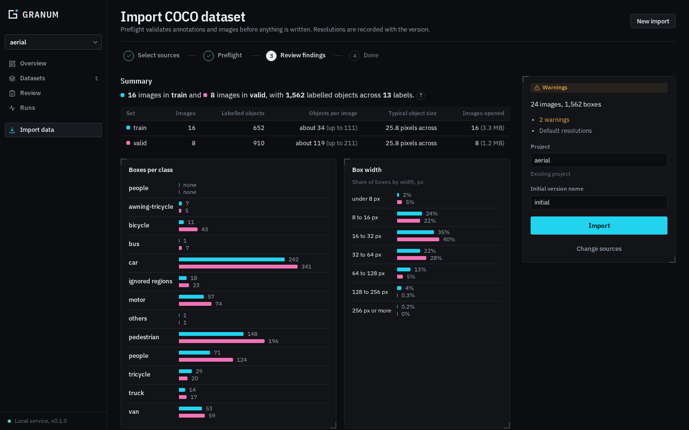

# Importing data

Import runs a **preflight** health check first and writes nothing until you have decided what to
do about each finding. The chosen option for every finding, the counts of what it changed and the
full report are stored with the new versions, so how a dataset came to be is always inspectable.



## Supported sources

| Source | Dashboard | CLI | Python |
|---|---|---|---|
| COCO JSON, one file per set | Yes | `granum import coco` | `Table.from_coco` |
| YOLO (`data.yaml`): detection, segmentation, pose, OBB | Yes | No | `Table.from_yolo_url(..., task=...)` |
| Image folder (class per subfolder) | Yes | No | `Table.from_image_folder` |
| Semantic class-ID/RGB PNG masks (`semantic.json`) | Yes | No | `Table.from_semantic_masks` |

For YOLO files without a declared task, choose the task in the source picker; boxes
are the default. Pose datasets require `kpt_shape`. Optional `kpt_names`, `flip_idx`,
`kpt_oks_sigmas` and `skeleton` metadata survive import and export. COCO RLE retains
exact mask pixels and holes; YOLO polygon export follows pixel contours and is lossy.

## Native semantic PNG masks

Place a `semantic.json` manifest beside the referenced files:

```json
{
  "format": "granum-semantic-masks",
  "version": 1,
  "ignore_index": 255,
  "categories": [{"id": 0, "name": "background"}, {"id": 1, "name": "object"}],
  "images": [{"file_name": "images/sample.png", "mask": "masks/sample.png"}]
}
```

Paths are relative to the manifest. Masks must have the same dimensions as their
images. Indexed/palette PNGs retain their class indices; 16-bit PNGs support class IDs
through 65535. RGB masks require `color: [r, g, b]` on every category and an
`ignore_color` when ignored pixels are present. Unknown classes/colors and overlapping
class regions are rejected. The ignore ID must differ from every class ID.

```python
table = Table.from_semantic_masks("data/semantic.json", project_name="roads")
granum.export_semantic_masks(table.latest(), "out/semantic", image_strategy="copy")
```

The dashboard discovers this manifest in the folder picker. Select **Semantic masks
(PNG)** when exporting a dataset version. Export uses class-ID PNGs and preserves
ignore regions; RGB source colors are normalized to IDs. The target SDK export folder
must be new or empty. Source images, masks and manifests must all be within the service's
configured data roots when using the dashboard.

## In the dashboard

1. **Import data** → browse to the dataset folder, or to any set folder inside it (`train/`, `valid/`, ...).
   The sets beside it are found as well.
2. Tick the sets to include and click **Add all sets**. Set names can be edited and must be unique.
   A single `.json` file can also be added on its own.
3. Choose image validation:
   - **All images**: decode every image to find missing, corrupt, duplicate and resized files.
   - **Sample, 200 per set**: faster; image problems outside the sample are not found.
   - **Annotations only**: images are not opened.
4. **Run preflight**, review the findings and adjust options.
5. Name the project (new or existing) and the initial version, then **Import**.

All sets go into one dataset, named after the folder that holds them. Every image starts
*Unreviewed* in the [Review tab](review-and-shipping.md).

## From the command line

```bash
# Report only; exits non-zero when there are blocking findings
granum import coco train=data/train/_annotations.coco.json valid=data/valid/_annotations.coco.json \
    --project aerial --check-only

# Import, overriding the default option of one finding
granum import coco train=... valid=... --project aerial --choose categories.ignore_region=drop

# Options
#   --media full|sample|none     how thoroughly to check images (default: full)
#   --dataset NAME               dataset name (default: the folder holding the set folders)
#   --fail-on block|warn|never   severity that makes the command fail (default: block)
#   --json                       print the report as JSON
```

## Checks

Each finding has a severity, evidence (counts per set, example images and boxes) and options with a default.

| Severity | Code | Finding |
|---|---|---|
| Blocking | `coco.unreadable` | The annotation file cannot be parsed |
| Blocking | `categories.conflict` | Category ids that disagree between sets |
| Blocking | `annotations.orphan` | Boxes on images that are not listed |
| Blocking | `annotations.unknown_category` | Boxes with undefined categories |
| Blocking | `annotations.invalid_bbox` | Malformed boxes |
| Blocking | `images.malformed`, `images.duplicate_id` | Broken or repeated image records |
| Blocking | `media.missing`, `media.unreadable` | Image files missing or undecodable |
| Warning | `categories.ignore_region` | "Ignore region" categories stored as classes |
| Warning | `categories.duplicate_name` | Different category ids sharing a name |
| Warning | `annotations.zero_area`, `annotations.out_of_bounds` | Zero-size boxes, boxes outside the image |
| Warning | `annotations.duplicate_id` | Repeated annotation ids |
| Warning | `media.size_mismatch` | Image size differs from the annotation |
| Warning | `media.identical_files` | Byte-identical files, including across sets |
| Warning | `images.export_copies`, `split.shared_source`, `split.shared_sequence` | Export copies or capture sequences shared between sets (leakage) |
| Info | `categories.unused`, `categories.catch_all` | Unused and catch-all categories |
| Info | `images.unannotated` | Images with no boxes: negatives or unlabelled? |
| Info | `annotations.tiny` | Boxes under 8 px |
| Info | `images.crowded` | Images with very many boxes |

Grouping options add `source_image`, `sequence` and `content_hash` columns so related images can
be reviewed, and split, together.

## What gets recorded

- The report: `<project>/imports/<id>.json`, also shown under **Overview → Attention** and linked from each set.
- The resolutions and their effects: in each new version's producer record.
- COCO fields are preserved: category ids, annotation ids, `iscrowd`, `area`, segmentation and
  extra fields, so an unedited export reproduces the file.

## Data roots

The service only reads import sources under configured **data roots** (default: your home folder).
Narrow them with `granum service --data-root /mnt/datasets` (repeatable) or the
`service.data-roots` setting. See [Service and CLI](service.md#configuration).
